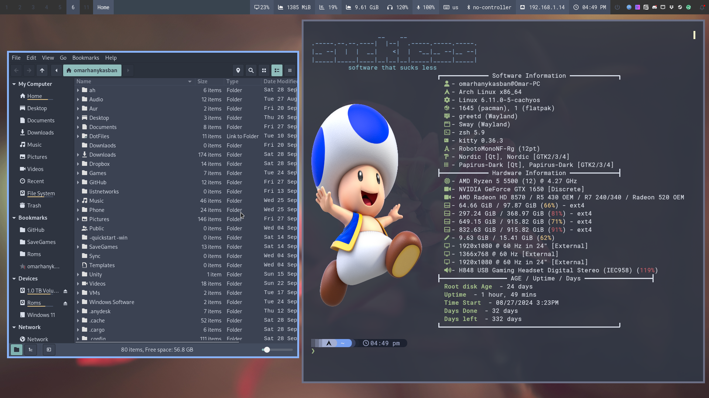

# SteavenGamerYT's Dotfiles



Personal dotfiles and desktop configurations for Arch Linux, Hyprland, Sway, i3, and BSPWM.

---

## Table of Contents

* [Overview](#overview)
* [Window Managers](#window-managers)
* [Configurations](#configurations)
* [Repository Structure](#repository-structure)
* [Installation](#installation)
* [Theme Switching](#theme-switching)
* [Updating](#updating)

---

## Overview

Dotfiles are customization files used to personalize Linux/Unix environments. This repository maintains configurations across machines with safe symlinks, automated backups, and theme toggling.

---

## Window Managers

| Window Manager | Config Link |
| :--- | :--- |
| **Hyprland** | [.config/hypr/hyprland.conf](.config/hypr/hyprland.conf) |
| **Sway** | [.config/sway/config](.config/sway/config) |
| **i3** | [.config/i3/config](.config/i3/config) |
| **BSPWM** | [.config/bspwm/bspwmrc](.config/bspwm/bspwmrc) |

---

## Configurations

| Category | Components |
| :--- | :--- |
| **Shells** | [bash](.bashrc) · [zsh](.zshrc) · [fish](.config/fish) · [.steavengameryt](.steavengameryt) |
| **Bars & Notifications** | [waybar](.config/waybar) · [polybar](.config/polybar) · [dunst](.config/dunst) · [swaync](.config/swaync) |
| **Terminals** | [kitty](.config/kitty) · [alacritty](.config/alacritty) · [starship](.config/starship) |
| **Launchers & Menus** | [rofi](.config/rofi) · [ulauncher](.config/ulauncher) |
| **Theming & System** | [MangoHud](.config/MangoHud) · [picom](.config/picom) · [fastfetch](.config/fastfetch) · [Kvantum](.config/Kvantum) · [BetterDiscord](.config/BetterDiscord) |

---

## Repository Structure

```text
dot-files/
├── .config/            # XDG user configuration directories (Hyprland, Waybar, Kitty, etc.)
├── .local/             # User data, Flatpak overrides, Nemo actions
├── .ssh/               # SSH client configuration
├── scripts/            # System & desktop management utilities
│   ├── theme-switcher.sh   # Switch between Nordic & Fluent dark themes
│   ├── patch-emulator-desktops.sh # Patch emulator desktop launchers for game-run
│   ├── cpu-mhz/        # CPU frequency management
│   ├── Audio/          # Per-machine audio configuration & services
│   └── Laptop/         # Asusctl fan & profile controls
├── misc/               # Exported data & backups (e.g., RSS OPML)
├── tools/              # Standalone utilities (vim-nano)
├── Screenshots/        # Showcase screenshots
├── install.sh          # Safe installer with automatic backups & dry-run support
├── update.sh           # Pull latest changes & refresh symlinks
├── theme.sh            # Quick launcher for Nordic theme
└── theme2.sh           # Quick launcher for Fluent theme
```

---

## Installation

Clone the repository and run the safe installer:

```bash
git clone https://github.com/SteavenGamerYT/dot-files.git ~/GitHub/dot-files
cd ~/GitHub/dot-files

# Preview changes without modifying anything
./install.sh --dry-run

# Run installation (existing files will be safely backed up to ~/.dotfiles_backup/)
./install.sh
```

### Desktop Settings

To apply matching GTK, cursor, and icon themes:

```bash
gsettings set org.gnome.desktop.interface cursor-theme 'WhiteSur-cursors'
gsettings set org.gnome.desktop.interface gtk-theme 'Nordic'
gsettings set org.gnome.desktop.interface cursor-size 24
gsettings set org.gnome.desktop.interface icon-theme 'Papirus-Dark'
gsettings set org.gnome.desktop.interface color-scheme 'prefer-dark'
gsettings set org.gnome.nautilus.preferences always-use-location-entry true
hyprctl setcursor WhiteSur-cursors 24
```

---

## Theme Switching

Easily switch themes across GTK (2/3/4), Qt/Kvantum, Waybar, SwayNC, Rofi, Kitty, Alacritty, Starship, Papirus folder icons, Hyprland, Sway, and i3:

```bash
# Apply Pure Nordic (Frost cyan/blue, Nordic GTK/Kvantum, Nordic folders)
./scripts/theme-switcher.sh nordic
# Or shortcut:
./theme.sh

# Apply Nordic Red / Adwaita Red (Burgundy accents, Mint-Y-Dark-Red, red folders)
./scripts/theme-switcher.sh red
# Or shortcut:
./theme3.sh

# Apply Fluent Dark (Adwaita Dark, Fluent-Dark, Adwaita folders)
./scripts/theme-switcher.sh fluent
# Or shortcut:
./theme2.sh
```

Running `./scripts/theme-switcher.sh` without arguments launches an interactive selection menu (supports both terminal and Rofi).

---

## Updating

Pull updates and refresh links:

```bash
./update.sh
```

